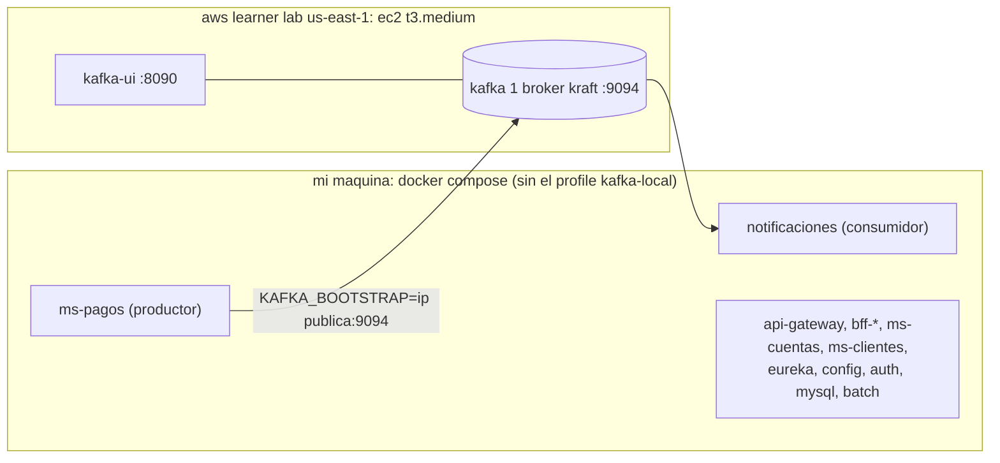

# despliegue

el sistema completo corre local con docker compose. en aws (learner lab) se despliega **solo kafka**, en una ec2 que arma un playbook de ansible, y los microservicios locales se conectan a ese broker remoto. asi lo pidio el profe, por eso no hay alb ni balanceador de aws: el balanceo y enrutamiento lo hacen spring cloud gateway + loadbalancer + eureka, igual que en local.



## 1. requisitos

- **aws academy learner lab**: entrar al curso, "Start Lab" y esperar que el circulo quede verde.
- **credenciales**: en "AWS Details" -> "AWS CLI: Show", copiar el bloque completo (trae `aws_access_key_id`, `aws_secret_access_key` y `aws_session_token`) a `~/.aws/credentials` como perfil `[default]`. son temporales, cada vez que se reinicia el lab hay que pegarlas de nuevo.
  ```bash
  aws configure set region us-east-1
  aws sts get-caller-identity      # tiene que mostrar la cuenta y un rol voclabs. si falla, estan vencidas
  ```
- **llave ssh**: en "AWS Details" bajar `labsuser.pem` (es el key pair `vockey` que ya existe en el lab), dejarla en `~/.ssh/labsuser.pem` y `chmod 600 ~/.ssh/labsuser.pem`.
- **local**: docker con compose, ansible (`brew install ansible` o `pipx install ansible`), aws-cli v2, curl y openssl.

## 2. levantar todo local

```bash
cp .env.example .env
docker compose up -d --build     # si la maquina tiene poca ram: primero docker compose --parallel 1 build
docker compose ps                # esperar que todo diga (healthy)
```

con el `.env` de ejemplo (`COMPOSE_PROFILES=kafka-local`) kafka y kafka-ui corren tambien en local. el paso a paso con todos los curl esta en [instrucciones.md](instrucciones.md).

## 3. kafka en ec2 con ansible

```bash
cd infra/ansible
ansible-galaxy collection install -r requirements.yml

# crea el security group, la ec2 (amazon linux 2023, ami sacada de ssm) y el inventory.ini
ansible-playbook provision.yml -e mi_ip=$(curl -s ifconfig.me)/32 \
  -e crear_key=false -e key_name=vockey -e key_file=~/.ssh/labsuser.pem

# instala docker igual que en la clase 7 (dnf install docker, systemctl enable, ec2-user al grupo docker)
# mas el plugin de compose, copia el compose de kafka (templates/kafka-compose.yaml.j2) y lo levanta.
# crea los topicos banco.transacciones (3 particiones) y banco.alertas-seguridad (1) y prueba el 9094 desde mi compu
ansible-playbook deploy.yml
```

al final `deploy.yml` imprime la linea para el `.env`: `KAFKA_BOOTSTRAP=<ip publica>:9094`.

el security group abre solo 3 puertos y solo para mi ip (`mi_ip`):

| puerto | para que |
|---|---|
| 22 | ssh, para ansible y para sacar la evidencia |
| 9094 | el listener externo de kafka, el que usan ms-pagos y notificaciones desde mi maquina |
| 8090 | kafka-ui, para ver topicos, mensajes y consumidores en el navegador |

kafka va en plaintext (sin tls ni usuario), por eso es importante que el 9094 no quede abierto a todo internet. el 9092 (listener interno) no se abre.

## 4. conectar lo local al kafka de la ec2

en el `.env` de la raiz:

```bash
COMPOSE_PROFILES=                     # vacio: no se levanta el kafka ni el kafka-ui locales
KAFKA_BOOTSTRAP=<ip publica>:9094
```

```bash
docker compose stop kafka kafka-ui    # si estaban arriba
docker compose up -d                  # recrea los servicios con el KAFKA_BOOTSTRAP nuevo
```

todos los servicios leen `${KAFKA_BOOTSTRAP:-kafka:9092}` y los `depends_on` hacia kafka tienen `required: false`, asi que arrancan sin el kafka local. para confirmar que usan la ip publica:

```bash
docker compose exec ms-pagos env | grep KAFKA                        # KAFKA_BOOTSTRAP=<ip>:9094
docker compose logs ms-pagos | grep -m1 "bootstrap.servers"          # bootstrap.servers = [<ip>:9094]
docker compose logs notificaciones | grep -m1 "bootstrap.servers"
```

si la ec2 no responde un rato las operaciones igual se hacen: el evento queda en el outbox de ms-pagos y se manda solo cuando vuelve kafka.

## 5. evidencia

con la ec2 arriba y el compose local apuntando a ella, estos son los comandos para mostrar que kafka corre en aws y que los microservicios lo usan:

```bash
# 1. la instancia (id, tipo, estado, ip y dns publico)
aws ec2 describe-instances --filters Name=tag:Project,Values=banco-xyz-eft Name=instance-state-name,Values=running \
  --query 'Reservations[].Instances[].{Id:InstanceId,Tipo:InstanceType,Estado:State.Name,IP:PublicIpAddress,DNS:PublicDnsName}' --output table

# 2. dentro de la ec2: contenedores y topicos
ssh -i ~/.ssh/labsuser.pem ec2-user@<ip> 'hostname; cd /opt/kafka-banco && docker compose ps'
ssh -i ~/.ssh/labsuser.pem ec2-user@<ip> 'docker exec kafka /opt/kafka/bin/kafka-topics.sh --describe --exclude-internal --bootstrap-server localhost:9092'

# 3. que ms-pagos y notificaciones (locales) apuntan a la ec2
docker compose exec ms-pagos env | grep KAFKA
docker compose logs notificaciones | grep -m1 "bootstrap.servers"

# 4. una transferencia por el gateway
WEB=$(scripts/token.sh web)
curl -sk -H "Authorization: Bearer $WEB" -H "Idempotency-Key: ec2-$(date +%s)" -H 'Content-Type: application/json' \
     -d '{"fromAccount":101,"toAccount":102,"amount":4321}' https://localhost:8443/api/web/transferencias | tee /tmp/transferencia.json
OP=$(sed -n 's/.*"operationId":"\([^"]*\)".*/\1/p' /tmp/transferencia.json); echo $OP

# 5. ese evento leido dentro de la ec2 (lee todo el topico y filtro por el operationId de la transferencia)
ssh -i ~/.ssh/labsuser.pem ec2-user@<ip> "docker exec kafka /opt/kafka/bin/kafka-console-consumer.sh --bootstrap-server localhost:9092 \
  --topic banco.transacciones --from-beginning --timeout-ms 10000 --property print.key=true 2>/dev/null" | grep "$OP"

# 6. notificaciones (local) lo consumio desde la ec2, y el grupo quedo con lag 0
OPS=$(scripts/token.sh ops)
curl -sk -H "Authorization: Bearer $OPS" https://localhost:8443/api/notificaciones | grep -o "{[^}]*${OP}[^}]*}"
ssh -i ~/.ssh/labsuser.pem ec2-user@<ip> 'docker exec kafka /opt/kafka/bin/kafka-consumer-groups.sh --bootstrap-server localhost:9092 --describe --group notificaciones'
```

y kafka-ui en `http://<ip>:8090`.

capturas para el informe y el video:

- consola de aws -> ec2 -> instances: `banco-xyz-eft` en running, con su ip y dns publico
- terminal con la sesion ssh y `docker compose ps` en la ec2
- kafka-ui en `http://<ip>:8090`: el broker, el topico `banco.transacciones` con el mensaje de la transferencia y el consumidor `notificaciones`
- `docker compose ps` local sin el contenedor kafka y el `env | grep KAFKA` de ms-pagos

## 6. alternativa manual con aws-cli

lo mismo que hace ansible, pero a mano:

```bash
export AWS_REGION=us-east-1
MI_IP=$(curl -s ifconfig.me)/32

# security group con los 3 puertos solo para mi ip
SG=$(aws ec2 create-security-group --group-name banco-xyz-eft-sg --description "kafka banco xyz eft" --query GroupId --output text)
for p in 22 9094 8090; do
  aws ec2 authorize-security-group-ingress --group-id $SG --protocol tcp --port $p --cidr $MI_IP
done

# amazon linux 2023 con la ami de ssm, key pair vockey del lab y el tag Project para encontrarla despues.
# el user-data instala docker como en la clase 7
cat > user-data.sh <<'EOF'
#!/bin/bash
dnf install -y docker
systemctl enable --now docker
usermod -aG docker ec2-user
mkdir -p /usr/local/lib/docker/cli-plugins /opt/kafka-banco
curl -sL https://github.com/docker/compose/releases/download/v2.29.7/docker-compose-linux-x86_64 \
  -o /usr/local/lib/docker/cli-plugins/docker-compose
chmod +x /usr/local/lib/docker/cli-plugins/docker-compose
EOF
AMI=$(aws ssm get-parameter --name /aws/service/ami-amazon-linux-latest/al2023-ami-kernel-default-x86_64 --query Parameter.Value --output text)
ID=$(aws ec2 run-instances --image-id $AMI --instance-type t3.medium --key-name vockey --security-group-ids $SG \
  --user-data file://user-data.sh \
  --tag-specifications 'ResourceType=instance,Tags=[{Key=Name,Value=banco-xyz-eft},{Key=Project,Value=banco-xyz-eft}]' \
  --query 'Instances[0].InstanceId' --output text)
aws ec2 wait instance-status-ok --instance-ids $ID
IP=$(aws ec2 describe-instances --instance-ids $ID --query 'Reservations[0].Instances[0].PublicIpAddress' --output text)

# el compose de kafka sale de la plantilla del playbook, cambiando las variables a mano
sed -e "s/{{ kafka_externo_port }}/9094/g" -e "s/{{ kafka_ui_port }}/8090/g" -e "s/{{ ansible_host }}/$IP/g" \
  infra/ansible/templates/kafka-compose.yaml.j2 > kafka-compose.yaml
scp -i ~/.ssh/labsuser.pem kafka-compose.yaml ec2-user@$IP:/tmp/docker-compose.yaml
ssh -i ~/.ssh/labsuser.pem ec2-user@$IP 'sudo mv /tmp/docker-compose.yaml /opt/kafka-banco/ && cd /opt/kafka-banco && docker compose up -d --wait'
echo "KAFKA_BOOTSTRAP=$IP:9094"
```

los topicos los crea ms-pagos al partir (y el playbook por si acaso). despues se sigue desde el paso 4.

## 7. limpieza

```bash
cd infra/ansible
ansible-playbook teardown.yml -e crear_key=false     # borra la ec2 y el security group, sin tocar vockey
```

a mano: `aws ec2 terminate-instances --instance-ids $ID`, `aws ec2 wait instance-terminated --instance-ids $ID` y `aws ec2 delete-security-group --group-id $SG`. en el `.env` volver a `COMPOSE_PROFILES=kafka-local` y borrar `KAFKA_BOOTSTRAP`.

ojo con el learner lab:

- se apaga solo a las 4 horas (o al hacer "End Lab"). las credenciales cambian en cada sesion.
- al volver a prender, la ec2 cambia de ip publica y kafka sigue anunciando la vieja: hay que correr `provision.yml` y `deploy.yml` de nuevo y actualizar `KAFKA_BOOTSTRAP` en el `.env`.
- si cambia mi ip (otra red), `provision.yml` actualiza el security group.

## 8. si se llevara todo a aws (mejora futura)

no lo hice porque el learner lab no deja crear roles iam y msk, rds y alb cuestan, pero el proyecto ya esta preparado: cada servicio es una imagen, la config sale del config-server y lo que cambia entre ambientes va por variables de entorno.

| local | aws |
|---|---|
| imagenes construidas con docker compose | **ecr**, un repositorio por servicio |
| contenedores del compose, `--scale` | **ecs fargate**, un servicio por microservicio, con autoescalado por cpu |
| kafka en una ec2 | **amazon msk** con 3 brokers (uno por zona) y `KAFKA_REPLICAS=3` |
| mysql con un schema por servicio (`mysql/init.sh`) | **rds mysql**, idealmente una por servicio |
| https autofirmado en el gateway | **alb** con certificado de **acm** delante del gateway |
| `.env` | **secrets manager**, inyectado en las task definitions |
| `docker compose logs` | **cloudwatch logs**, buscando por traceId |
| `docker compose run batch` | tarea ecs programada con eventbridge, con reintento |
