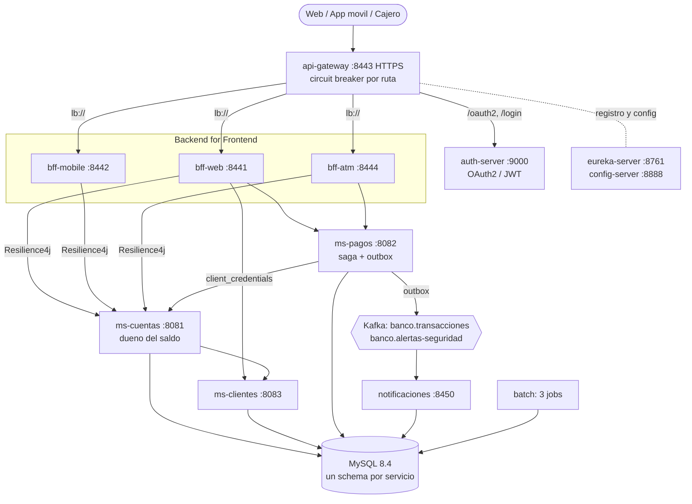
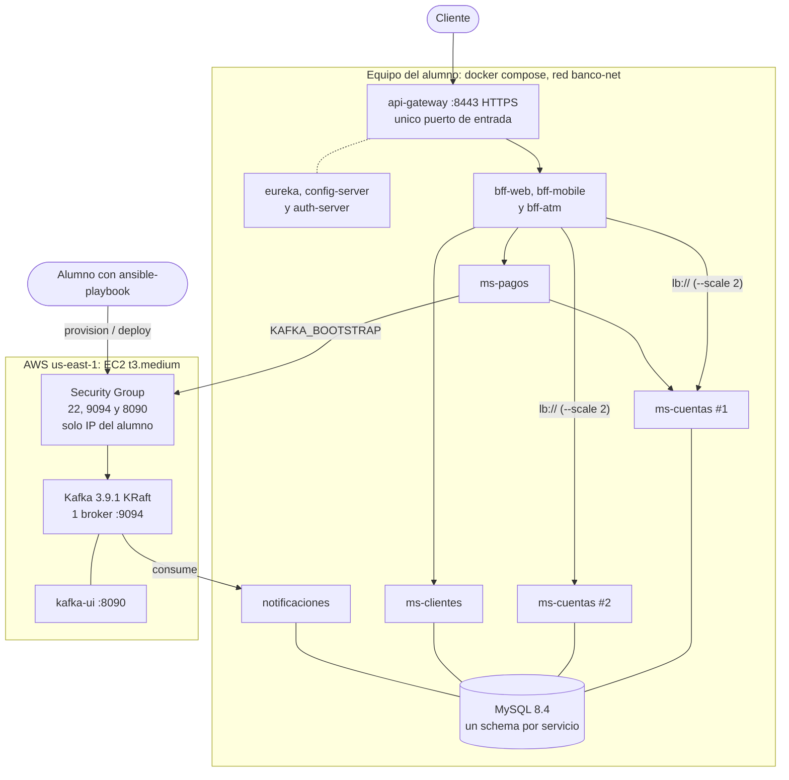
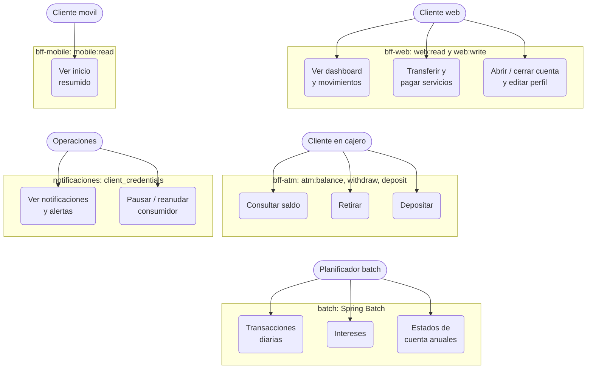
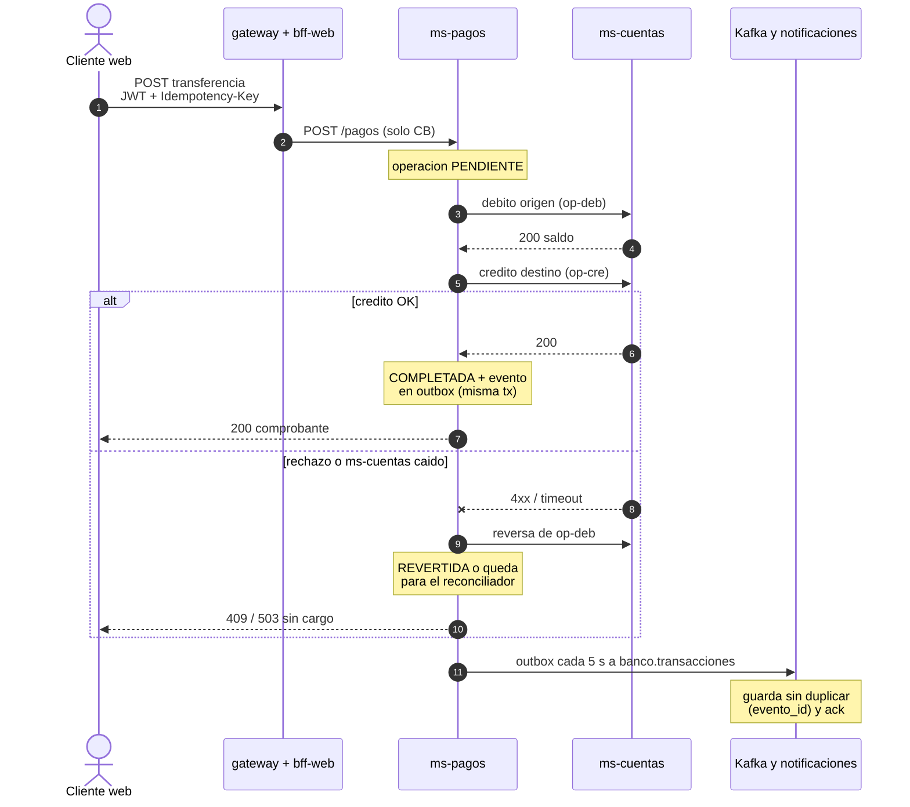
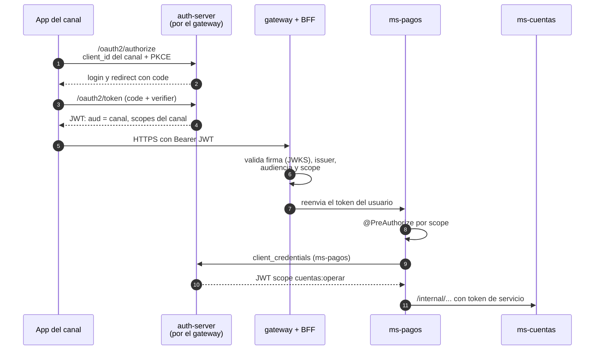
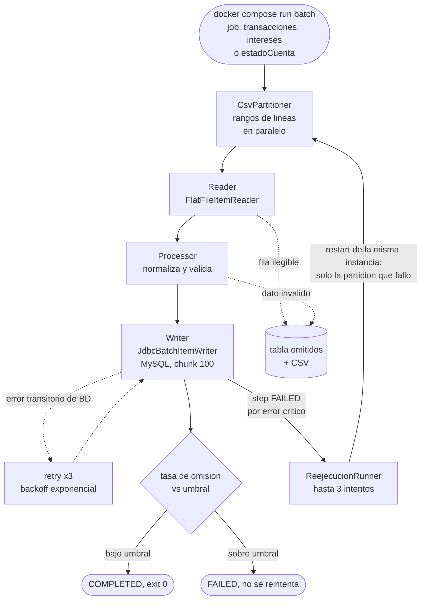
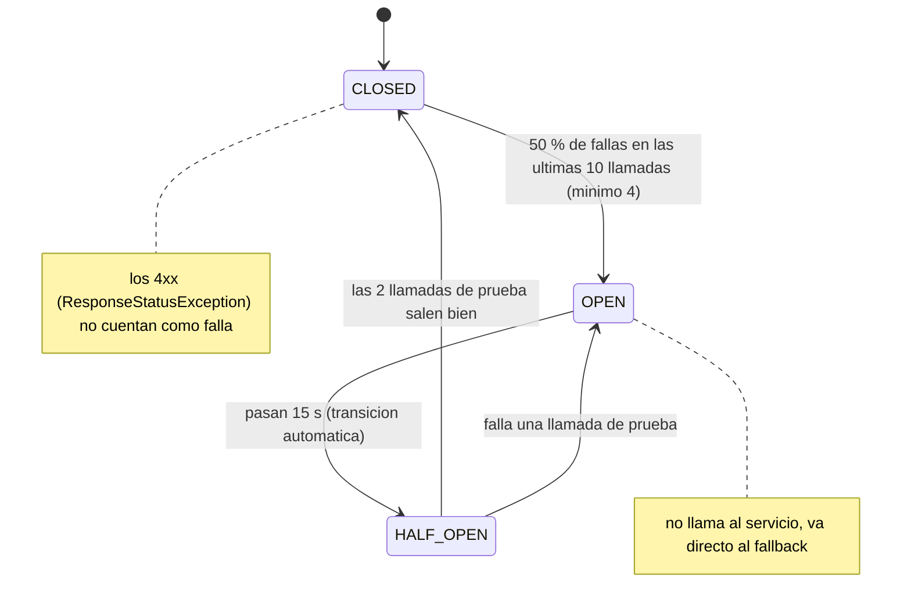
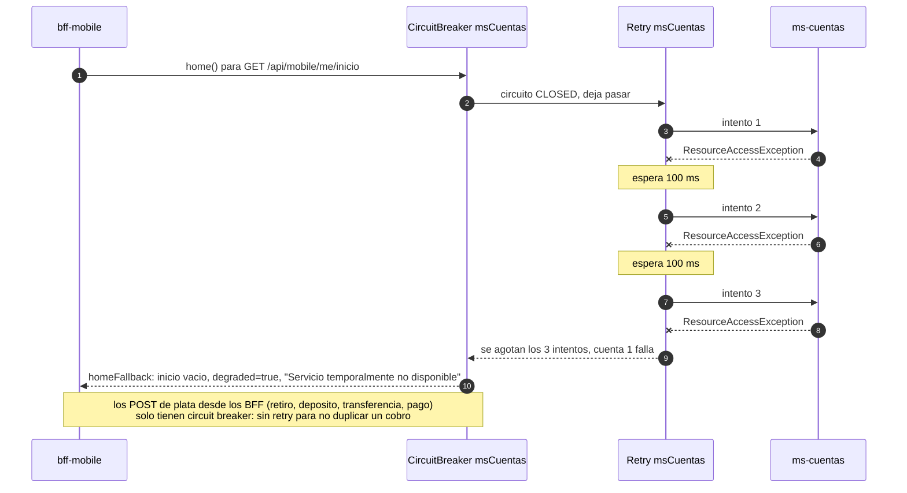
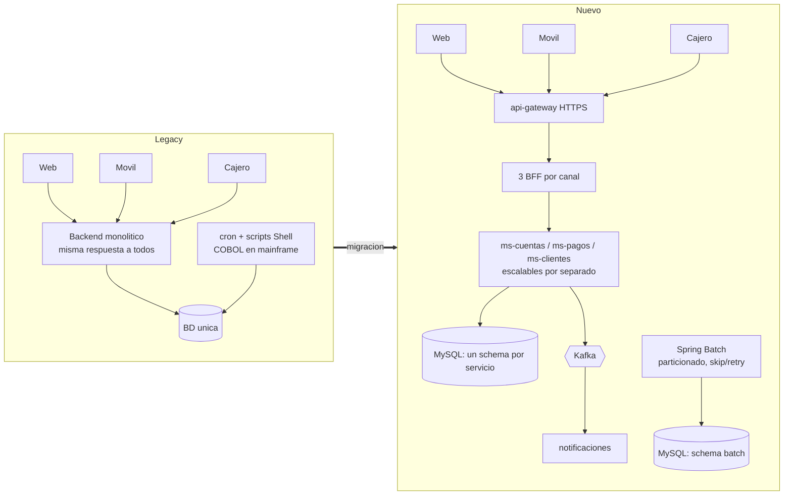

# Arquitectura Banco XYZ (EFT S9)

Diagramas del informe en mermaid (github los dibuja solo). Los png estan en `docs/diagramas/`, se generan con `mmdc -i archivo.mmd -o archivo.png -b white -s 2`.

Repo de la entrega: https://github.com/Dalvae/banco-xyz-eft

## Arquitectura general

Los canales entran por el api-gateway en https (8443), que enruta con lb:// al bff de cada canal. Los bff y los microservicios se registran en eureka y sacan su config del config-server. ms-pagos es el que mueve la plata: le pide a ms-cuentas el debito y el credito y publica los eventos en kafka. Cada servicio tiene su propia base.

## Despliegue: Docker Compose + Kafka en AWS

Los servicios corren con docker compose en una red de docker. Solo el gateway (y los paneles) publican puerto; los microservicios no tienen container_name ni puerto en el host para poder hacer `docker compose up --scale ms-cuentas=2`. En aws va solo kafka: 1 broker kraft (apache/kafka:3.9.1) en una ec2 t3.medium de 20 GB levantada con ansible (`infra/ansible`), con el listener externo 9094 y kafka-ui en 8090; el security group abre 22, 9094 y 8090 solo a mi ip. deploy.yml crea los topicos (rf 1) e imprime el KAFKA_BOOTSTRAP. Si la ec2 se reinicia cambia la ip y hay que correr provision.yml y deploy.yml de nuevo. Los servicios apuntan ahi con `KAFKA_BOOTSTRAP`. No hay balanceador de aws, el balanceo es el del gateway + loadbalancer + eureka (ver `despliegue.md`).

## Casos de uso por canal

Cada canal tiene su bff y sus scopes: la web lee y escribe, el movil solo lee un resumen y el cajero solo consulta saldo, retira y deposita.

## Transferencia: saga con compensacion y evento Kafka

No hay transaccion distribuida. ms-pagos guarda la operacion como PENDIENTE, debita, acredita y si el credito falla pide la reversa del debito. El evento se guarda en la tabla outbox en la misma transaccion que el estado COMPLETADA y otro proceso lo manda a kafka cada 5 s.

## OAuth2 por canal

Un cliente por canal (bank-web, bank-mobile, bank-atm) con authorization code + pkce. Entre servicios ms-pagos usa su propio token client_credentials con el scope cuentas:operar.

## Jobs de Spring Batch

Los 3 jobs particionan el csv por rangos de lineas y procesan las particiones en paralelo. Las filas malas se saltan y quedan en la tabla omitidos, los errores transitorios de bd se reintentan 3 veces y si se pasa el umbral de omision el job termina FAILED.

## Circuit breaker: estados

Config de config-repo/application.yml: ventana 10, minimo 4 llamadas, 50 % de fallas, 15 s abierto y 2 llamadas en half-open. Los 4xx no cuentan como falla.

## Circuit breaker + retry

El circuit breaker va afuera y el retry adentro (aspect-order 1 y 2): 3 intentos cada 100 ms y despues el fallback. Se usa de los bff a los ms y tambien entre ms (ms-pagos -> ms-cuentas, ms-cuentas -> ms-clientes). Los POST de plata desde los bff solo llevan circuit breaker para no duplicar un cobro.

## Legacy vs nuevo

Resumen de lo que cambia con la migracion.

