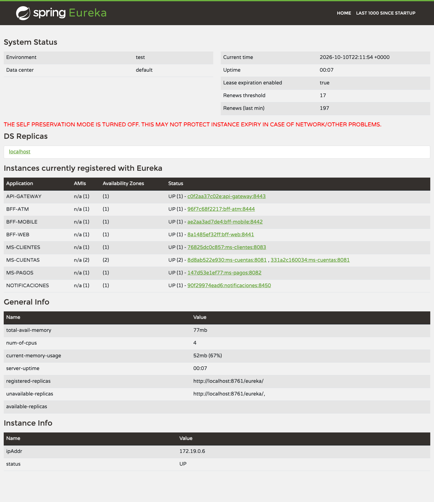
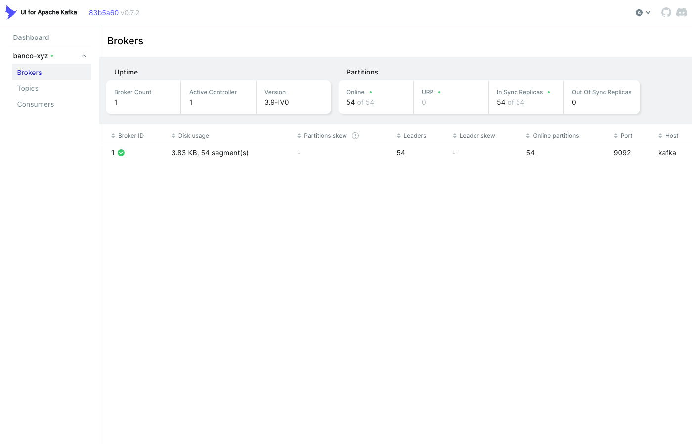
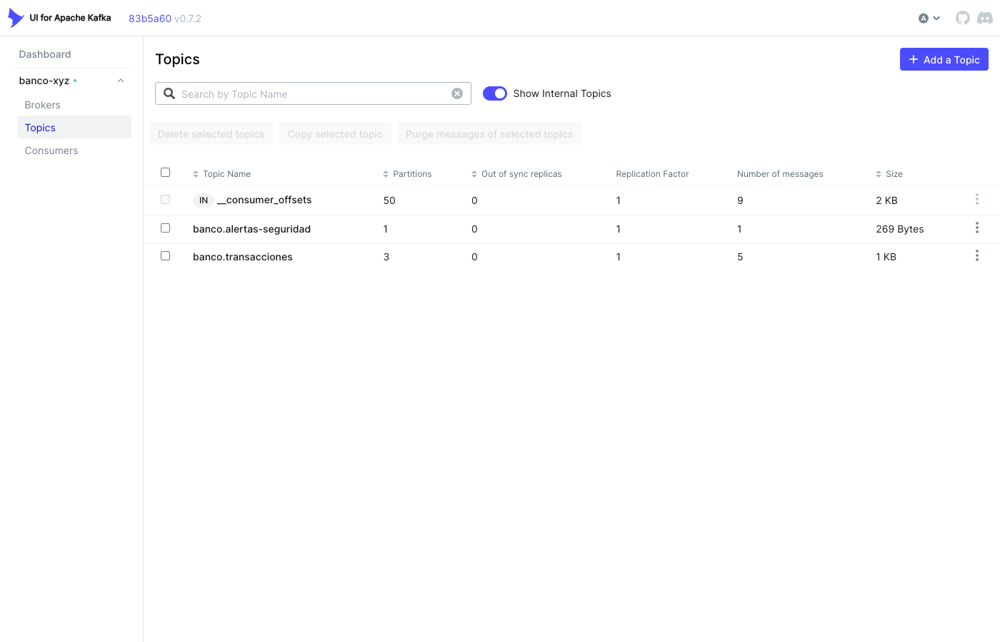
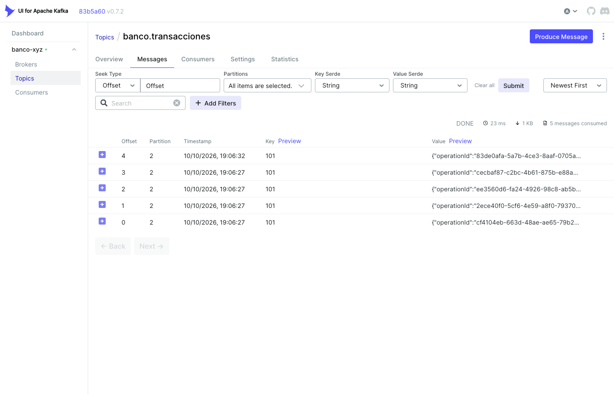
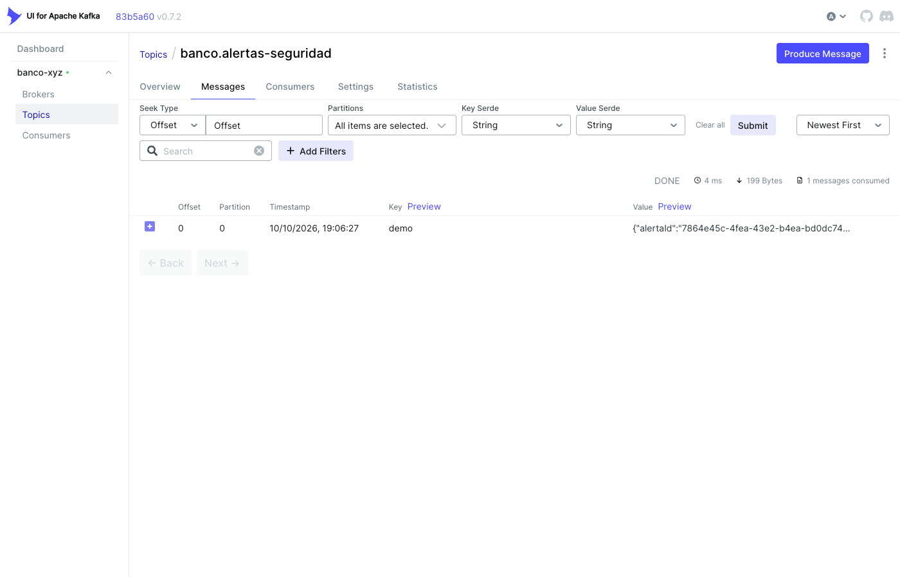
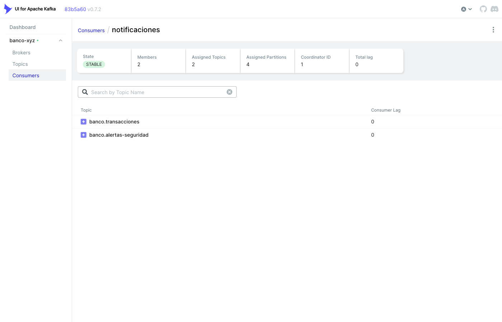
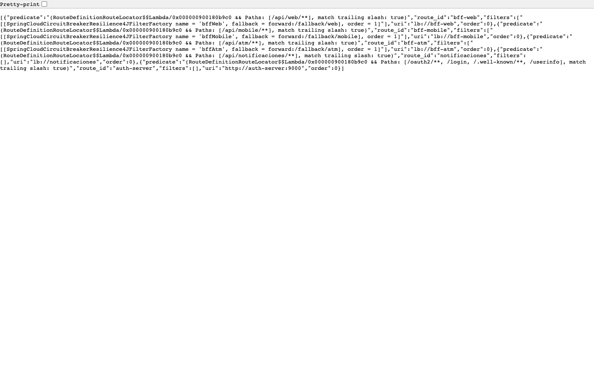
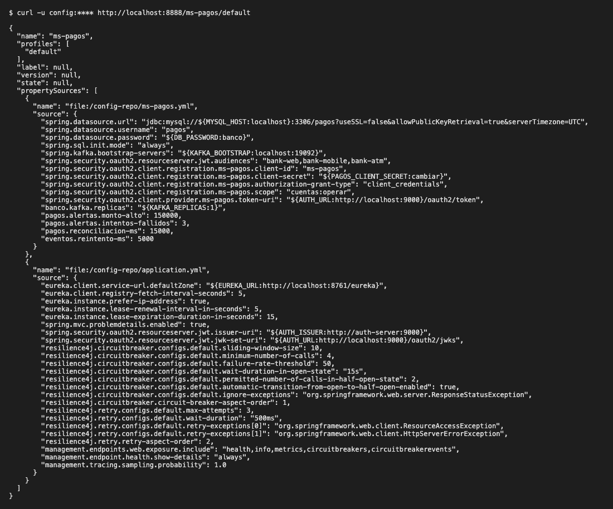
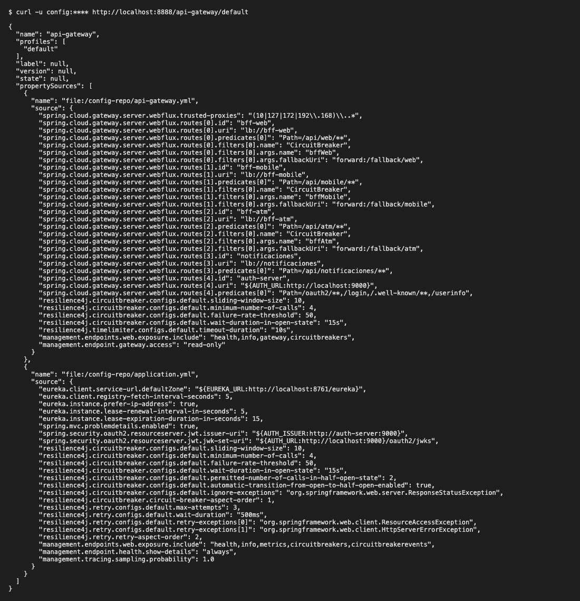
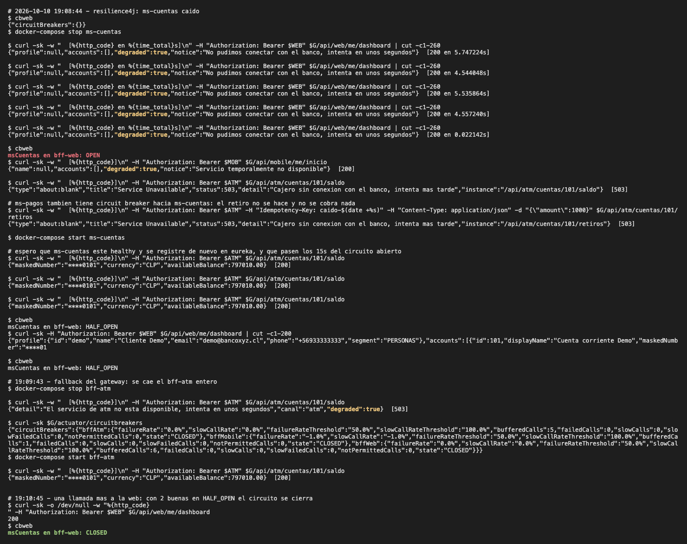

# banco xyz - eft desarrollo backend III

repo: https://github.com/Dalvae/banco-xyz-eft

evaluacion final transversal (PBY2203). junte lo que venia haciendo en el ramo: el proyecto spring batch de las semanas 1 a 3 y los microservicios de la semana 8 (auth-server, bff por canal, resilience4j, kafka), y le agregue lo que faltaba para que quede como una arquitectura de microservicios con spring cloud:

- bank-api (que era un monolito chico) lo separe en **ms-cuentas**, **ms-pagos** y **ms-clientes**, cada uno con su base
- **config-server** (spring cloud config, perfil native) con la config de todos en `config-repo/`
- **eureka-server** para que los servicios se encuentren por nombre y se puedan tener varias replicas
- **api-gateway** (spring cloud gateway) como unica entrada, en https, que reparte con `lb://`
- el **batch** quedo como un modulo mas, con los csv de [fin_legacy_data](https://github.com/KariVillagran/fin_legacy_data) y reejecucion automatica si falla
- un solo `docker-compose.yaml` que levanta todo (mysql, kafka, kafka-ui y los 12 servicios)

como se ejecuta y prueba cada cosa paso a paso esta en [instrucciones.md](instrucciones.md), y como se llevaria a aws en [despliegue.md](despliegue.md).

## arquitectura

```
                                  +-------------------+     +---------------+
                                  |   config-server   |     | eureka-server |
                                  |  :8888 (native,   |     |    :8761      |
                                  |   config-repo/)   |     +---------------+
                                  +-------------------+       ^ todos se registran
                                     ^ todos piden su config   | y se buscan por nombre
                                                               |
 web / movil / cajero                                          |
        |  https                                               |
        v                                                      |
 +--------------+   lb://bff-web     +-----------+             |
 | api-gateway  | -----------------> |  bff-web  | --+         |
 |  :8443 https | lb://bff-mobile    +-----------+   |  lb://  |
 | (circuit     | -----------------> | bff-mobile| --+-------> ms-cuentas (x2) ---> mysql/cuentas
 |  breaker +   | lb://bff-atm       +-----------+   |          ^   |
 |  fallback)   | -----------------> |  bff-atm  | --+          |   +--> ms-clientes ---> mysql/clientes
 +--------------+                    +-----------+   |          |
        |                                            +-------> ms-pagos ---> mysql/pagos
        | /oauth2, /login                                         |  (saga + outbox)
        v                                                         v
 +-------------+                                     kafka: banco.transacciones
 | auth-server |  todos validan el jwt con /oauth2/jwks    banco.alertas-seguridad
 |   :9000     |                                                  |
 +-------------+                                                  v
                                                           notificaciones ---> mysql/notificaciones

 batch (one-shot): csv de fin_legacy_data ---> spring batch (3 jobs) ---> mysql/banco_xyz_batch
```

el flujo de un retiro en el cajero: `curl -k https://localhost:8443/api/atm/cuentas/101/retiros` -> el gateway lo manda a una instancia de bff-atm (por eureka) -> bff-atm valida el token (audiencia `bank-atm`, scope `atm:withdraw`) y llama a `ms-pagos` -> ms-pagos guarda la operacion, le pide el debito a `ms-cuentas` con su propio token client_credentials y deja el evento en el outbox -> el outbox lo publica en `banco.transacciones` (y en `banco.alertas-seguridad` si es de $150.000 o mas) -> notificaciones lo consume y lo guarda.

## servicios y puertos

| servicio | puerto | hacia afuera | que hace |
|---|---|---|---|
| api-gateway | 8443 | **si (https)** | unica entrada. rutas `lb://` a los bff, circuit breaker con fallback, tambien pasa `/oauth2` y `/login` al auth-server |
| config-server | 8888 | si (con clave) | spring cloud config native, lee `config-repo/` |
| eureka-server | 8761 | si | registro de servicios, en la pagina se ven las instancias |
| auth-server | 9000 | no (por el gateway) | spring authorization server: tokens por canal y para servicios |
| ms-cuentas | 8081 | no | **gestion de cuentas**: apertura, cierre, mantenimiento (renombrar), saldo y movimientos. dueno del saldo |
| ms-pagos | 8082 | no | **procesamiento de pagos**: retiros, depositos, transferencias y pago de servicios. saga + outbox + productor kafka |
| ms-clientes | 8083 | no | **gestion de clientes**: datos personales y perfil |
| bff-web | 8441 | no | dashboard completo, movimientos, transferir, pagar, abrir/cerrar cuenta, editar perfil |
| bff-mobile | 8442 | no | inicio liviano (nombre, cuentas y ultimos movimientos, nada mas) |
| bff-atm | 8444 | no | saldo, retiro y deposito, respuestas minimas |
| notificaciones | 8450 | no (por el gateway) | consumidor kafka de los 2 topicos |
| batch | - | - | spring batch, corre un job y termina |
| mysql | 3306 | no | un schema y un usuario por servicio |
| kafka | 9092 / 19092 | 19092 | 1 broker kraft |
| kafka-ui | 8090 | si | ver topicos, mensajes y consumidores |

los 3 ms, los 3 bff y notificaciones no tienen `container_name` ni puerto publicado, asi se pueden escalar con `--scale`.

## estructura

```
shared/          lo comun: cliente http con @LoadBalanced, seguridad (resource server), eventos kafka, dtos
config-server/   spring cloud config
config-repo/     la config de cada servicio (application.yml es la comun)
eureka-server/   registro de servicios
api-gateway/     spring cloud gateway con https
auth-server/     oauth2 (spring authorization server)
ms-cuentas/ ms-pagos/ ms-clientes/   los 3 microservicios
bff-web/ bff-mobile/ bff-atm/        un bff por canal
notificaciones/  consumidor kafka
batch/           spring batch (3 jobs) + data/ con los csv de fin_legacy_data
docker/mysql/    script que crea los schemas y usuarios
docker-compose.yaml
scripts/         token.sh (saca tokens con curl) y certificado.sh (keystore para correr local)
infra/ansible/   playbook para el despliegue en ec2 (ver despliegue.md)
evidencias/      salidas de terminal y capturas
```

## como ejecutar (resumen)

necesitas docker con compose (yo use colima con 8gb y 4 cpu) y curl + openssl. java no hace falta porque las imagenes compilan adentro.

```bash
cp .env.example .env
docker-compose --parallel 1 build    # de a una, asi maven compila una sola vez y las demas usan el cache
docker-compose up -d
docker-compose ps                    # esperar que todo diga healthy (2 a 3 min)
```

el detalle con todos los curl esta en [instrucciones.md](instrucciones.md).

los tests: `mvn package` (necesita java 21 y maven), corren sin docker (h2 en modo mysql y kafka mockeado).

## como se cubre cada requisito

### parte 1: batch

- **3 jobs** read/process/write: `transaccionesJob` (movimientos diarios, detecta anomalias y deja un resumen por dia), `interesesJob` (intereses trimestrales sobre ahorro y prestamos) y `estadoCuentaJob` (estados de cuenta anuales + reporte de auditoria). cada uno con `FlatFileItemReader` -> processor que normaliza y valida -> `JdbcBatchItemWriter`.
- **excepciones y reintentos**: los datos malos (fecha invalida, monto vacio, tipo raro) se saltan con una `SkipPolicy` y quedan en la tabla `omitidos` y en un csv. los fallos temporales de la bd (`TransientDataAccessException`) se reintentan 3 veces con backoff exponencial.
- **volumen**: cada job esta particionado (`CsvPartitioner`), las particiones corren en paralelo en un pool de hilos y el writer usa batch inserts (`rewriteBatchedStatements`).
- **finalizacion y reejecucion automatica**: si un job descarta mas registros que su umbral queda FAILED (y el contenedor sale con codigo 1). si un step falla por algo critico, `ReejecucionRunner` relanza el job con los mismos parametros, que para spring batch es un restart: sigue desde la particion/chunk que fallo sin repetir lo que ya estaba escrito. hasta 3 intentos con espera creciente. y si el proceso entero se muere, al volver a partir retoma la ejecucion que quedo FAILED (en compose tiene `restart: on-failure:3`). se puede ver con `--batch.demo.falla-critica=true`.
- los csv de fin_legacy_data estan en `batch/data/semana_1..3`, por defecto procesa `semana_3` (1000 filas por archivo).

### parte 2: bff

- **bff-web**: datos completos (perfil, todas las cuentas con saldo, movimientos paginados, operaciones) y las operaciones de escritura.
- **bff-mobile**: una sola llamada `/me/inicio` con lo esencial, sin datos personales extra.
- **bff-atm**: solo saldo, retiro y deposito. no devuelve nombres ni movimientos. el retiro no se reintenta (es plata) y lleva `Idempotency-Key`.
- **auth por canal**: cada canal es un cliente distinto en el auth-server (`bank-web`, `bank-mobile`, `bank-atm`) con sus propios scopes. cada bff solo acepta tokens con su audiencia, asi el token del celular no sirve en el cajero (401), y cada endpoint pide su scope con `@PreAuthorize` (403 si no lo tiene).
- **https y tokens**: el gateway es la unica entrada y va en https con un certificado pkcs12 autofirmado que se genera en el Dockerfile (en local con `scripts/certificado.sh`). el login y los tokens tambien pasan por el gateway. adentro de la red de docker va en http (en aws el https lo termina el alb con acm).
- los bff son independientes: cada uno su modulo, su imagen y su config.

### parte 3: microservicios con spring cloud

- **3 microservicios** con su propia base (database per service: schema y usuario de mysql distintos, ms-pagos no puede leer las tablas de ms-cuentas).
- **spring cloud config**: `config-server` con perfil native. cada servicio solo tiene su nombre y puerto en el `application.properties`, lo demas (bd, eureka, seguridad, resilience4j, rutas del gateway) sale de `config-repo/`.
- **eureka**: todos se registran, y se llaman por nombre (`http://ms-cuentas`, `lb://bff-web`).
- **balanceo y enrutamiento**: spring cloud gateway enruta por path a cada bff y spring cloud loadbalancer reparte entre las instancias (gateway -> bff y bff/ms-pagos -> ms-cuentas con `@LoadBalanced`). con `--scale ms-cuentas=2` se ven las 2 en eureka y en los logs las 2 atienden.
- **oauth2**: auth-server con spring authorization server, authorization code + PKCE para los canales y client credentials para servicio a servicio (ms-pagos -> ms-cuentas con el scope `cuentas:operar`, que ningun canal tiene). todos los servicios son resource servers.
- **resilience4j y fallback**: circuit breaker + retry en los bff (si ms-cuentas se cae la web y el movil responden con `degraded: true` y el cajero da 503), en ms-pagos hacia ms-cuentas, en ms-cuentas hacia ms-clientes, y en el gateway si se cae un bff entero.
- **kafka**: topicos `banco.transacciones` (transaccion completada) y `banco.alertas-seguridad` (monto alto o 3 rechazos seguidos en 10 min). productor: ms-pagos con outbox. consumidor: notificaciones con ack manual y sin duplicados.
- **consistencia**: no hay transacciones distribuidas, es una saga: ms-pagos guarda la operacion, pide debito y credito a ms-cuentas (idempotentes por operationId) y si el credito falla pide la reversa del debito. si ms-cuentas no responde para revertir, la operacion queda `COMPENSACION_PENDIENTE` y un reconciliador la termina cada 15s. el evento se guarda en la misma transaccion que cierra la operacion (outbox), asi nunca se publica algo que no paso ni se pierde algo que si.
- **monitoreo**: actuator en todos (`health`, `metrics`, `circuitbreakers`), traceId/spanId en los logs (micrometer tracing) para seguir una operacion por varios servicios, y kafka-ui.
- **escalado horizontal**: ms-*, bff-* y notificaciones se escalan con `--scale`. probado con 2 replicas de ms-cuentas.
- **docker / aws**: un Dockerfile por servicio y un compose. el despliegue a aws (ecr, ecs fargate o ec2, msk, rds, alb con acm, secrets manager, cloudwatch, autoescalado) esta en [despliegue.md](despliegue.md), con un playbook de ansible en `infra/ansible/` para el camino ec2.

## evidencias

salidas reales de mi terminal en [evidencias/](evidencias/) (todas del 2026-10-10, con el compose arriba en colima):

| archivo | que muestra |
|---|---|
| `00-mvn-package.txt` | `mvn package` en verde, 34 tests en 13 modulos |
| `01-e2e.txt` | tokens por el gateway, los 3 bff, 401/403 por canal, retiro, deposito, transferencia, pago, saga que devuelve la plata, idempotencia, abrir/cerrar cuenta, perfil, notificaciones y el grupo de consumidores de kafka |
| `02-resilience4j-fallback.txt` | ms-cuentas caido: reintentos, circuito OPEN, fallback degradado en web/movil, 503 en el cajero, HALF_OPEN y CLOSED al volver; fallback del gateway con bff-atm caido |
| `03-escalado-eureka.txt` | `--scale ms-cuentas=2`, las 2 instancias en eureka y las llamadas repartidas 6/5 entre las 2 |
| `04-batch.txt` | los 3 jobs como contenedor one-shot, conteos en mysql y la reejecucion automatica (FAILED -> restart de la misma instancia -> COMPLETED) |
| `05-docker-stats.txt` | memoria de todo arriba (unos 2,9 GB con 2 replicas de ms-cuentas) |

capturas en [evidencias/capturas/](evidencias/capturas/):



| | |
|---|---|
|  |  |
|  |  |
|  |  |
|  |  |



## cosas que faltaron o simplifique

- kafka quedo en 1 broker en docker (en s8 tenia 3). lo baje antes de medir para no arriesgarme con los 8gb de colima y 12 servicios java; al final todo arriba usa ~2,9 gb, asi que probablemente 3 brokers de 384m tambien cabian, pero no lo probe. en aws seria msk con 3.
- un solo mysql con un schema por servicio, en aws seria un rds por servicio (o al menos usuarios separados como aca).
- usuarios y clientes del auth-server en memoria, y la llave se genera al partir (si se reinicia hay que pedir tokens de nuevo).
- el certificado es autofirmado, por eso los curl van con `-k`.
